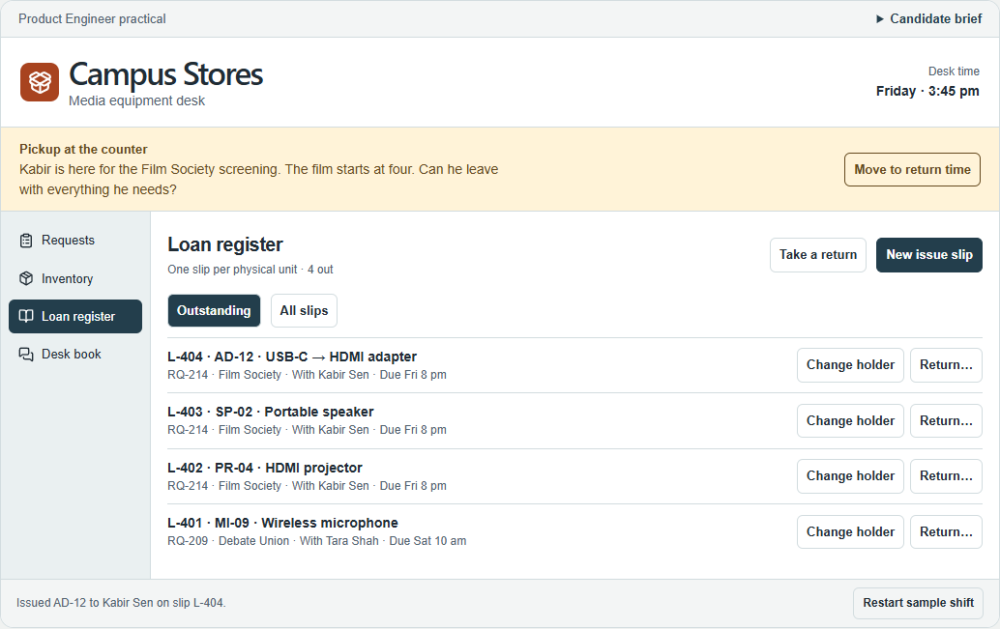
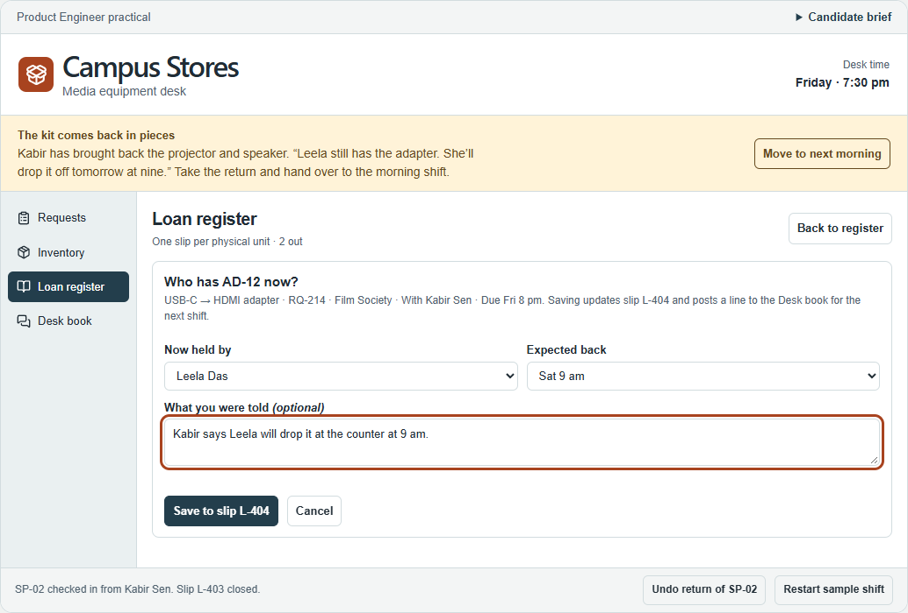
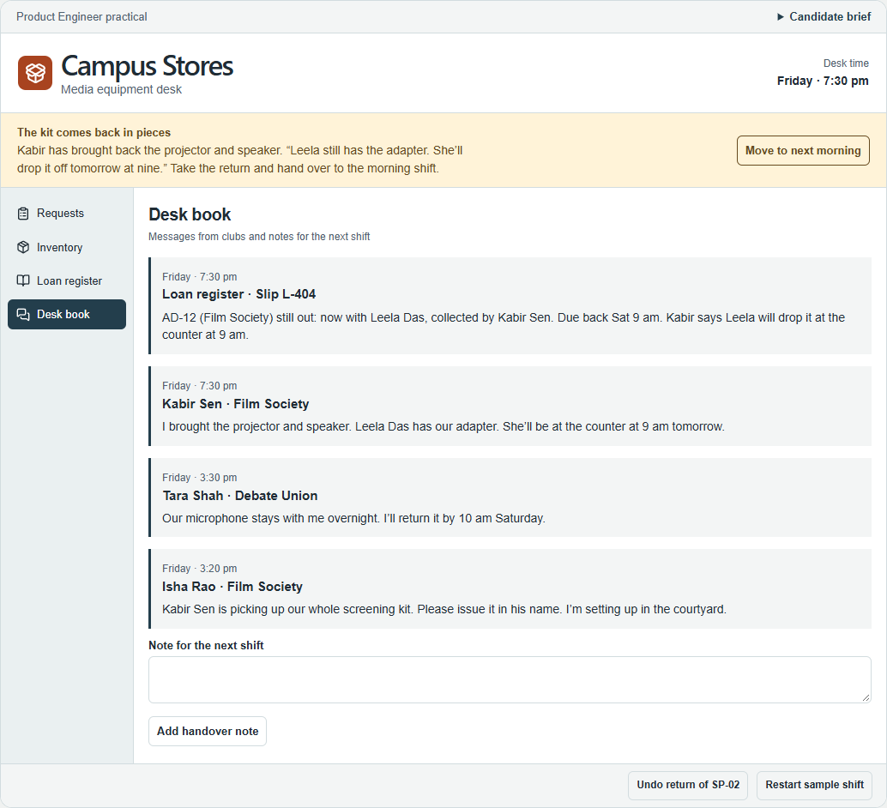
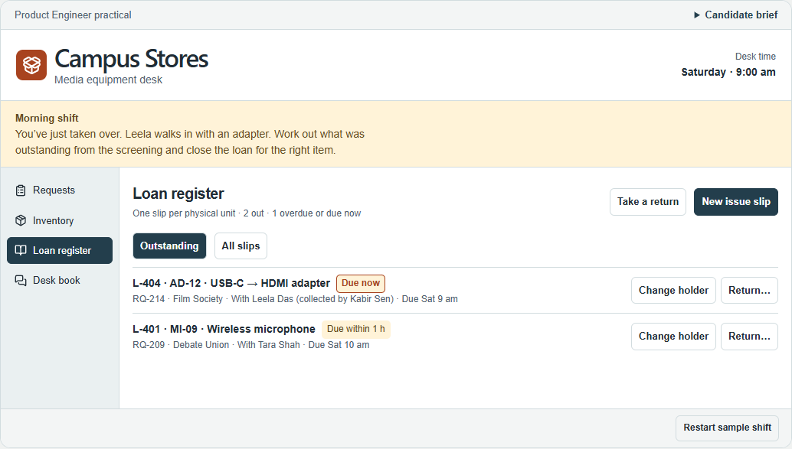
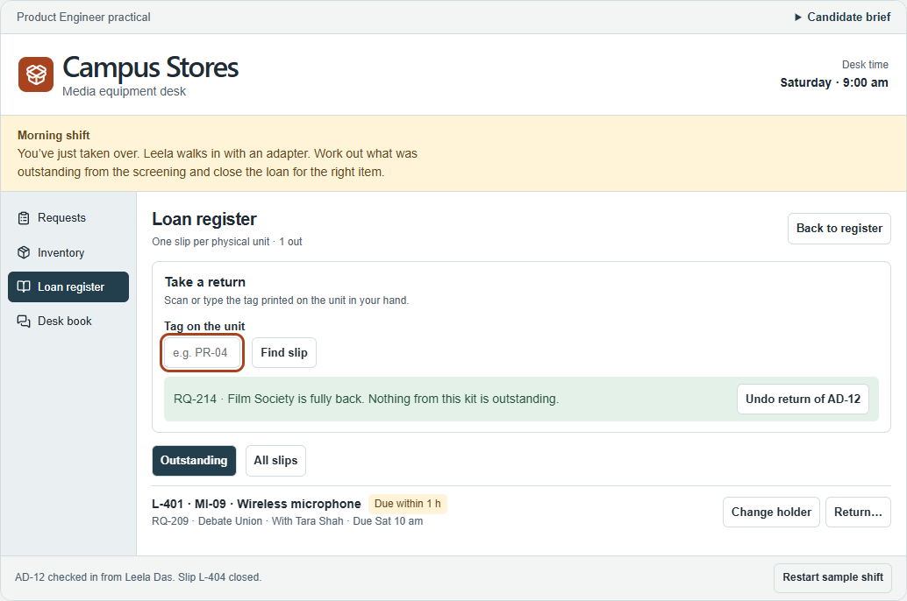

# Campus Stores

Campus Stores is a Product Engineer work sample set at a fictional campus media equipment desk. Work through a club’s screening, from equipment pickup to a partial return and the next morning’s handover. Open **Candidate brief** in the app for the assignment.

---

## For reviewers

**My decision:** keep the issue side as it is. Change one thing on the return side: when a unit stays out, who has it and when it's due back get recorded **on its slip**, and a slip is closed by reading the tag on the unit in hand.

To try it, open `index.html` and play the shift with the time button: pickup → *Move to return time* → *Move to next morning*. The change is in **Loan register**.

### A moment the product handles well: issuing at 3:45 pm

While issuing Kabir's kit, I tried to add the Photo Circle's camera (CA-03) to the Film Society's request RQ-214. The register refused: *“This equipment type is outside the approved request.”* I also tried a second speaker (SP-05) on the same request and got *“The approved quantity of this equipment type is already on loan.”* The projector that's in the workshop (PR-06) never appears as a choice.

The approved request decides what can go out, and every physical unit gets its own slip: L-402 PR-04, L-403 SP-02, L-404 AD-12. I didn't change any of this. My change depends on it, because one slip per tagged unit is what makes a tag lookup possible.

### A moment I would change: recording Leela at 7:30 pm

Kabir returned the projector and speaker and said Leela had the adapter and would bring it at 9 am. I went to record that on L-404 and couldn't. The slip only offers *Record return*. It kept saying *Kabir Sen · Due Fri 8 pm*. The only place for "Leela has it, back Sat 9 am" was a free-text Desk book note, on another screen.

The next morning shows why this matters. The new person on shift sees L-404 under Kabir's name, due last night, with no sign that it's late. Then Leela, whose name isn't on any slip, hands over "an adapter". Two identical adapters (AD-12 and AD-15) share bin C4, and *Record return* closes a slip in one click without asking which unit is on the counter.

### The change

1. **Who has it, on the slip.** After each check-in, the register lists anything from the same request that's still out, with a button such as *Record who has AD-12*. Every open row also has *Change holder*. You record the new holder, the new due time and, optionally, what you were told. The slip then reads *With Leela Das (collected by Kabir Sen) · Due Sat 9 am* and keeps a dated history line. The same line is posted to the Desk book.
2. **Close by tag.** *Take a return* asks for the tag on the unit in your hand and finds that unit's slip. A row's *Return…* button opens the same panel, already expecting that unit, and still asks for the tag. If you enter a tag that isn't on loan (AD-15), it's refused. The error names the open slip and who has it, not the tag. The register list still shows tags, though, so this only works if the label gets read. See Limits.
3. **A check before handover.** If part of a kit came back during the shift and nobody recorded who has the rest, *Move to next morning* stops once and shows *Before you hand over: RQ-214 came back in part. L-404 · AD-12 still lists Kabir Sen, due Fri 8 pm.* The two buttons are *Record who has AD-12* and *Hand over anyway*.

So the morning shift can see what's late, slips are also flagged against desk time (*Overdue*, *Due now*, *Due within 1 h*). Small extras: the last return can be undone, and the Requests list shows how much of each kit is out.

### Walkthrough: the same job with the change

**Fri 3:45 pm.** Pickup is unchanged: three slips to Kabir, due Fri 8 pm.



**Fri 7:30 pm.** I opened *Take a return*, read PR-04 and closed L-402, then read SP-02 and closed L-403. The panel then showed what was still out from RQ-214:


If I had skipped that step and tried to end the shift, the register would have asked first:


I clicked *Record who has AD-12*, chose Leela Das and Sat 9 am, and added what Kabir said:



Saving the slip also writes the Desk book entry:



**Sat 9:00 am.** In the register, L-404 is under Leela's name and flagged *Due now*. Tara's microphone, due at 10, is flagged separately.



Leela hands over an adapter. If the tag reads AD-15, the register refuses it:


When the tag reads AD-12, the register shows L-404 with its history, and I close it:




### What I'd keep

- The approved-request and quantity checks.
- Units in repair can't be issued.
- One slip per physical unit.
- The Desk book as the place clubs and shifts write to each other.
- The single-file app that runs offline.

I left the issue form alone. Picking the same four fields three times for one kit is slow, but nothing gets lost there.

### What I considered and rejected

- **Block time from moving forward until the missing unit is recorded.** A desk can't stop a shift ending. Instead the register asks once, at handover, and lets you go on.
- **Reassign the slip to Leela.** This loses the fact that Kabir collected the unit. If something goes wrong later, the desk needs both names.
- **Close Kabir's slip and open a new one for Leela.** The unit never came back to the desk, so a new slip would record a pickup that never happened. It would also split one loan's history across two slips.
- **Choose the returned unit from a dropdown.** That's the same guess as clicking a row, just in a different control. Only the label on the unit says which adapter it is.

### Limits

The tag check helps only if the person on shift reads the label. Typing a tag is weaker than scanning one. A USB barcode scanner types into the same field, which would close that gap. Recording who has a unit is asked for at handover, not enforced. *Hand over anyway* is there because the counter, not the software, knows when the shift ends.

### Tests

`tests/` plays the whole shift in a headless browser and checks it. Run `cd tests && npm install && npm test`. The app itself still needs no install.

### One observation at a real counter

> When someone returns a unit for a borrower who isn't named on the slip, does the person on shift look at the unit's label before typing or scanning the tag?

If they type from memory or copy it from the screen instead, the change hasn't helped.

### Why I think this applies beyond a campus desk

In a 2021 study of about 18,000 shared infusion pumps across 27 hospitals in British Columbia, about 4% of the fleet was consistently misplaced across sites, and about 5% hadn't been seen on the network for over three months. The main cause was pumps moving with patients between units and hospitals without being sent back ([Cesconetto & Rose, CMBES 2021](https://proceedings.cmbes.ca/index.php/proceedings/article/download/968/877/2028)). That's the adapter problem: the unit moved and the record didn't. I'd check whether a multi-site hospital group sees the same before assuming it does.

---

## Run the app

Open `index.html` in a modern browser. The app includes its scripts, styles, and icons and can run offline.

To serve it over local HTTP, run this from the repository folder and visit `http://localhost:8000`.

```sh
python3 -m http.server 8000 --bind 127.0.0.1
```

Each browser stores its own sample shift locally when browser storage is available. **Restart sample shift** restores the fictional starting records.

## Source

- `index.html` contains the desk layout, candidate brief, and bundled icons.
- `app.js` contains the sample records and interactions.
- `styles.css` defines the desktop and mobile layouts.
- `docs/walkthrough/` holds the screenshots used above.
- `tests/` holds the optional end-to-end test suite.

Icon license notices are in [third-party/lucide-LICENSE.txt](third-party/lucide-LICENSE.txt).


## Submit your work

1. [Fork Campus Stores](https://github.com/virinchi-healthcare/campus-stores/fork) into your GitHub account. Complete the candidate brief and push your changes to your public fork. In your README, point reviewers to your work and explain the decision you made.
2. In your fork, open **Commits**, select the final commit you want reviewed, and copy the page URL. It should look like `https://github.com/YOUR-USERNAME/campus-stores/commit/COMMIT-SHA`.
3. [Submit your work through the Google Form](https://docs.google.com/forms/d/e/1FAIpQLScvzoh1R4WS-SkiwAVBQbMvniieJYSoOEfLMyVo5CyjOvYUgQ/viewform). Your **roll number**, **email ID**, and **final commit link from your public fork** are required. Enter your roll number and email ID in the form only.
